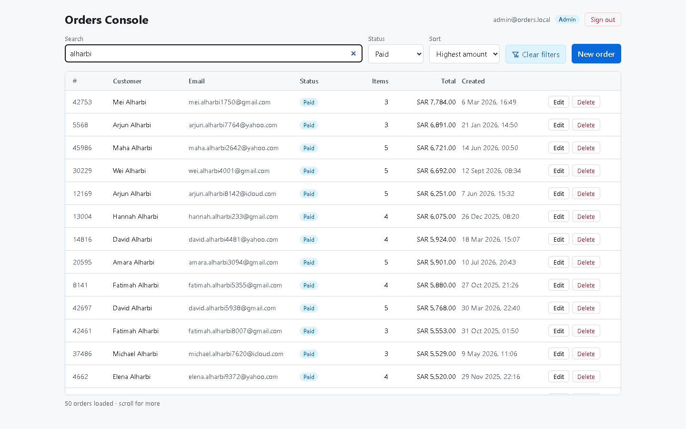
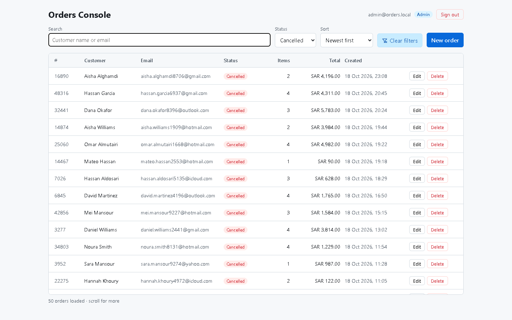
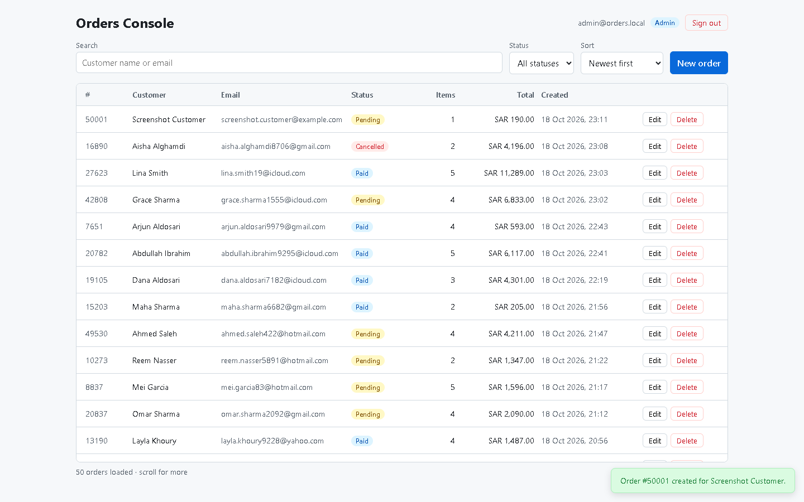

# orders-console
A full-stack Orders Console built with React, Node.js, and a real database, featuring server-side filtering, pagination, and duplicate-safe order creation.

## Getting started

Requires Node.js 20.12+ (developed on Node 24). No database server to install — SQLite runs in-process and stores its data in `server/data/orders.db`.

```bash
npm install          # installs both workspaces (client + server)
npm run db:seed      # creates the schema and seeds 50,000 orders + 2 users (~5s, resets existing data)
npm run dev          # API on http://localhost:4000, UI on http://localhost:5173
npm test             # R2 proof: duplicate create requests produce exactly one order
```

`npm test` seeds a throwaway database, starts **two** API processes on it, and fires the same create request at both at once (2× and 20×), then checks the database holds exactly one order. Two processes rule out the guarantee coming from Node running one request at a time. It also covers sequential retries, a key reused with different details (422), and requests without a valid key (400).

To see the rapid-filter behaviour (R1), run the API with random latency so responses arrive out of order: `SIMULATED_LATENCY_MS=1500 npm run dev` (PowerShell: `$env:SIMULATED_LATENCY_MS=1500; npm run dev`).

`npm run db:seed -- --orders=200000` seeds a different number of orders. The data is deterministic: every run produces the same orders.

### Seeded users

| Role  | Email                | Password     |
| ----- | -------------------- | ------------ |
| admin | `admin@orders.local` | `Admin#2026` |
| agent | `agent@orders.local` | `Agent#2026` |

Sign-in sessions end when the API restarts unless `JWT_SECRET` is set (see `server/.env.example`).

Optional: copy `server/.env.example` to `server/.env` (and `client/.env.example` to `client/.env`) to override the defaults.

## Screenshots

**Screen recording (2:37):** [docs/video/demo.mp4](docs/video/demo.mp4), a walkthrough of the running console.

Captured from the running app with `SIMULATED_LATENCY_MS=1500` (each list request delayed by a random 0–1.5 s).

**R1: search, filter and sort.** Searching "alharbi" with status Paid and sort "Highest amount" gives 50 rows per page and more on scroll; the filters are kept in the URL (`/orders?q=alharbi&status=paid&sort=highest`), so a refresh or a shared link reopens the same view. Signed out, the app lives at `/login` and returns to that view after sign-in.



**R1: rapid filter changes.** The status was switched Paid → Pending → Cancelled in quick succession, then I waited past the maximum latency. Every row is Cancelled: no earlier, slower response replaced the latest one. In this run the browser log shows the superseded request aborted (`net::ERR_ABORTED`) and only the final filter's request completing.



**R2: create with a double-click.** The Create button was double-clicked. The new order appears once, and the database holds exactly one order with that name.



**R2: the duplicate proof (`npm test`).** Two API processes share one database, and the same request goes to both at once:

```
▶ POST /api/orders is idempotent
  ✔ the same request fired twice in parallel creates exactly one order
  ✔ 20 parallel duplicates across two processes still create exactly one order
  ✔ a sequential retry returns the original order instead of a new one
  ✔ reusing a key for a different order is rejected, not silently merged
  ✔ different keys are different orders, even with identical details
  ✔ a request without a valid key, or with an invalid body, creates nothing
ℹ tests 6
ℹ pass 6
ℹ fail 0
```

## Project structure

```
client/               React 18+ · Vite · TypeScript
  src/api/            HTTP calls to the back end
  src/components/     Shared UI components (Modal)
  src/features/       Screens and their hooks (auth, orders)
  src/lib/            Small shared helpers
server/               Node · Express · TypeScript
  src/config/         Environment loading and validation
  src/auth/           Login, session tokens, auth middleware, password hashing
  src/db/             SQLite connection, migrations, seed script
  src/orders/         Orders API: validation, queries, routes
  src/middleware/     Cross-cutting Express middleware
  src/routes/         HTTP route handlers
```

## Indexes (R1)

The list never sends the table to the browser: it fetches 50 rows at a time with a keyset cursor, and only visible rows are rendered. Each query shape has an index (see [migrations.ts](server/src/db/migrations.ts)):

| Index | Serves |
| ----- | ------ |
| `idx_orders_created_at (created_at, id)` | Sort by date, no status filter |
| `idx_orders_total (total_cents, id)` | Sort by amount, no status filter |
| `idx_orders_status_created_at (status, created_at, id)` | Status filter + sort by date |
| `idx_orders_status_total (status, total_cents, id)` | Status filter + sort by amount |
| `orders_search` (FTS5, trigram) | Search on customer name or email, 3+ characters |
| `idx_order_items_order_id (order_id)` | Item count per order |
| `idx_orders_idempotency (created_by, idempotency_key)`, unique | R2 duplicate protection |

The trailing `id` in each sort index is the keyset tie-breaker, so "the page after (value, id)" is one index range scan. `EXPLAIN QUERY PLAN` shows a covering index search with no temporary sort for every filter and sort combination, and a page takes about 3 ms whether it is the first or the 500th. Searches of 1–2 characters use an escaped `LIKE` scan instead (the trigram index needs 3); see DECISIONS.md.

## Editing and deleting orders

Not required by the brief, but part of a usable console:

- **Edit (agents and admins).** `GET /api/orders/:id` loads the order with its items, and `PUT /api/orders/:id` replaces the customer, status and items, with the total recomputed on the server.
  - Edits use optimistic locking. The form sends the `version` it was opened with, and the update only applies `WHERE version = ?`.
  - If someone else saved in between, the second save gets 409 instead of silently overwriting the first.
  - Edits are not retried automatically: a retry of a save that did go through would wrongly report a conflict.
- **Delete (admins only).** See the code review below.

## Code review: the contractor's auth middleware

Every problem I found in the `auth.ts` / `routes.ts` snippet from the brief, and what replaced it. The fixed code lives in [`server/src/auth/`](server/src/auth/) and [`server/src/orders/orders.routes.ts`](server/src/orders/orders.routes.ts).

| # | Problem | Why it matters | What I changed |
| - | ------- | -------------- | -------------- |
| 1 | `jwt.decode` instead of `jwt.verify` | The signature is never checked: anyone can hand-write a token saying `"role": "admin"` and be an admin. | `jwt.verify`, with the algorithm pinned to HS256 ([token.ts](server/src/auth/token.ts)). |
| 2 | Secret hard-coded in source | Anyone who has the repo (or the brief) can sign valid tokens. | `JWT_SECRET` from the environment, at least 32 characters, required in production. In development an unset secret becomes a random one per run, so there is no default to leak. |
| 3 | Token accepted from `?token=` | URLs are written to server and proxy logs, browser history and `Referer` headers. | The token is read from an httpOnly cookie only. |
| 4 | No expiry | `jwt.sign` sets no `expiresIn`, and `decode` ignores `exp` anyway: a leaked token works forever. | Sessions expire after `SESSION_TTL_HOURS` (default 8), enforced by `verify`. |
| 5 | Admin check only in the React `AdminOnly` component | Hiding a button is cosmetic; any agent can call `DELETE /orders/:id` with curl. | `requireRole("admin")` on the server ([auth.middleware.ts](server/src/auth/auth.middleware.ts)). The UI still shows the Delete button only to admins, but only for convenience. If the server answers 403 anyway (for example, the role changed after the page loaded), the dialog says so and the app re-reads the role. |
| 6 | Plain-text passwords, compared inside the query | One database leak exposes every password. | Salted scrypt hashes with a constant-time comparison ([password.ts](server/src/auth/password.ts)). |
| 7 | Login body not validated | `email` can arrive as an object, such as `{"not": ""}` for Prisma or `{"$ne": null}` for MongoDB, and log in without a password. | zod accepts only strings: email format, length limits, 400 otherwise. |
| 8 | No brute-force protection | Unlimited password guesses. | 10 failed attempts per 15 minutes per IP, then 429 ([auth.routes.ts](server/src/auth/auth.routes.ts)). |
| 9 | Role baked into the token | A demoted or deleted user keeps their access until the token expires, which here is never. | The token carries only the user id; the user and role are loaded from the database on every request. |
| 10 | Delete route trusts `req.params.id` and always answers `ok` | `DELETE /orders/abc` reaches the ORM; a missing order still reports success; in Express 4 a rejected `await` leaves the request hanging. | Id validated (400), 404 when nothing was deleted, Express 5 forwards async errors to the error handler. |
| 11 | `req.user = payload` is untyped | Whatever the token decodes to flows through the app unchecked. | A typed `Request.user` ([express.d.ts](server/src/types/express.d.ts)), set only from a database row. |
| 12 | Each route must remember to add `requireAuth` | One forgotten middleware exposes a route. | `ordersRouter.use(requireAuth)` protects every orders route, including future ones. |

Deleting one order is an admin decision kept separate from the bulk delete in the product question below. It is a hard delete because that is what the original route did; in a real production system I would make it a soft delete or archive with an audit entry.

While fixing #6 I also closed a timing leak: hashing a password takes ~50 ms, so answering instantly for unknown emails would reveal which emails have accounts. Unknown emails are compared against a dummy hash, so both paths take the same time and return the same message.

### Where the token lives on the client

The session token is in an httpOnly, `SameSite=Strict` cookie scoped to `/api` (and `Secure` in production). Page JavaScript cannot read it, so an XSS bug cannot steal the token and replay it from elsewhere, and other sites cannot make the browser send it (CSRF). It does not protect against XSS itself: a script injected into our page can still call the API as the user while the tab is open, so that has to be prevented at the source (React's escaping, no `dangerouslySetInnerHTML`, a Content Security Policy).

A second, readable cookie, `orders_signed_in=1`, is set on login and cleared on logout. It is not a credential: the server never reads it, and every protected route still checks the real session and role. It only lets the login screen load without an API call. When it is present, the app confirms the session with `/api/auth/me`; if the server has already ended the session, that one request returns 401, the hint is removed and the login screen is shown. Forging it achieves nothing beyond that one 401.

## Product question: "Delete all cancelled orders"

Before building it I would ask why. What problem do cancelled orders cause: clutter in the list, wrong reports, storage? Who still needs them: finance for refunds and chargebacks, support when a customer asks "why was I charged?", auditors? Is there a legal retention period? Does "all" include an order cancelled ten minutes ago that may still be disputed?
If she cannot answer, I would not build an irreversible bulk delete. Instead I would hide cancelled orders from the default view (the status filter already exists), and if storage really is the concern, archive orders cancelled more than N months ago. That would be admin-only, logged and reversible.

## What I skipped and why

- **Optional tasks O1 (slow stats API) and O2 (optimistic create).** The brief says doing one badly costs more than skipping it, so I spent the time on R1 and R2 correctness. After a create, the list refetches rather than updating optimistically.
- **Automated tests beyond R2.** `npm test` covers R2 only. During development I verified the rest with throwaway scripts that are not committed: every page of 5 filter/sort combinations and 11 search cases against an independent reference, 26 auth checks (forged, unsigned, expired and wrong-algorithm tokens, `?token=`, role checks, the rate limit), and 12 edit checks (including two concurrent edits of the same version). The rapid-filter behaviour has no automated client test; check it by hand with `SIMULATED_LATENCY_MS`. These are the first tests I would add.
- **Shared types between client and server.** The API types, the status list and the order validation rules are duplicated in `client/` and `server/`. A shared workspace package would stop them drifting.
- **Total result count.** The list shows "N orders loaded" instead of "N of M", which avoids a `COUNT(*)` on every filter change.
- **Production hardening.**
  - The login rate limiter is in memory, per process.
  - Behind a reverse proxy, `trust proxy` must be set.
  - CSRF protection relies on `SameSite=Strict` cookies and JSON-only endpoints, with no CSRF token.
  - Idempotency keys never expire.
